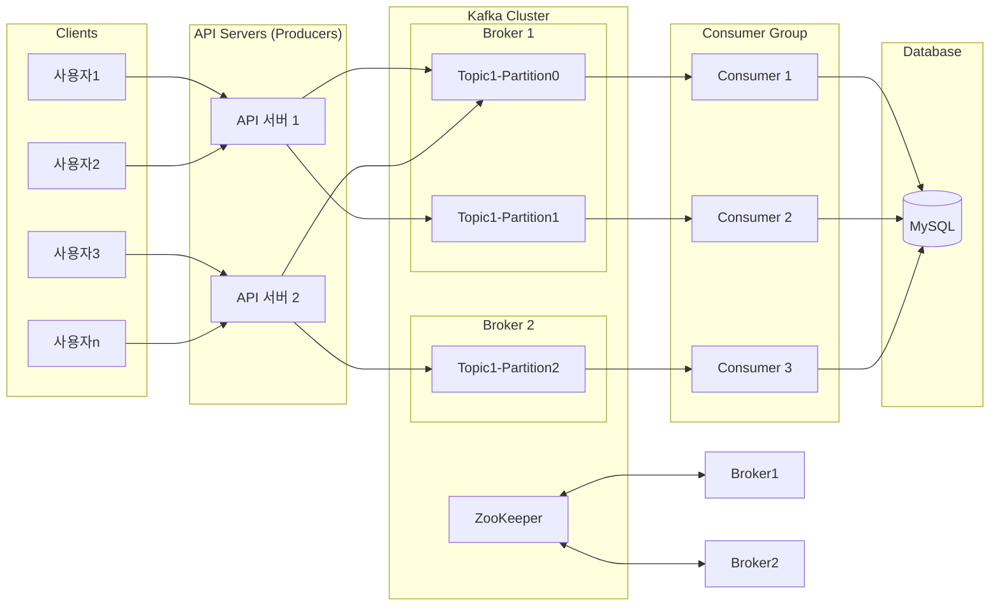
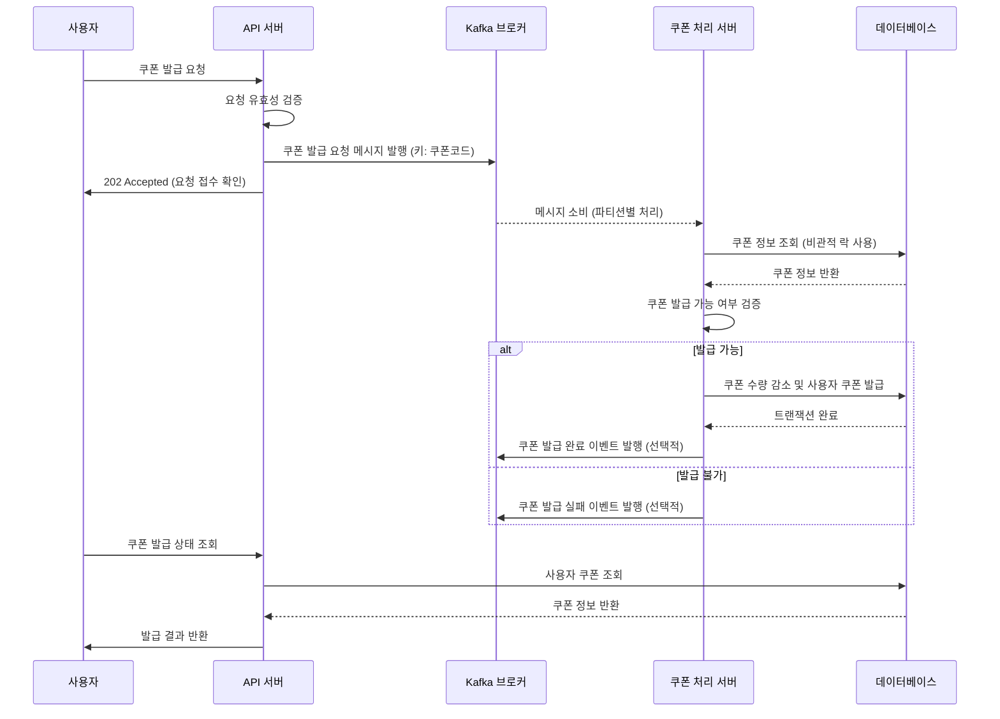
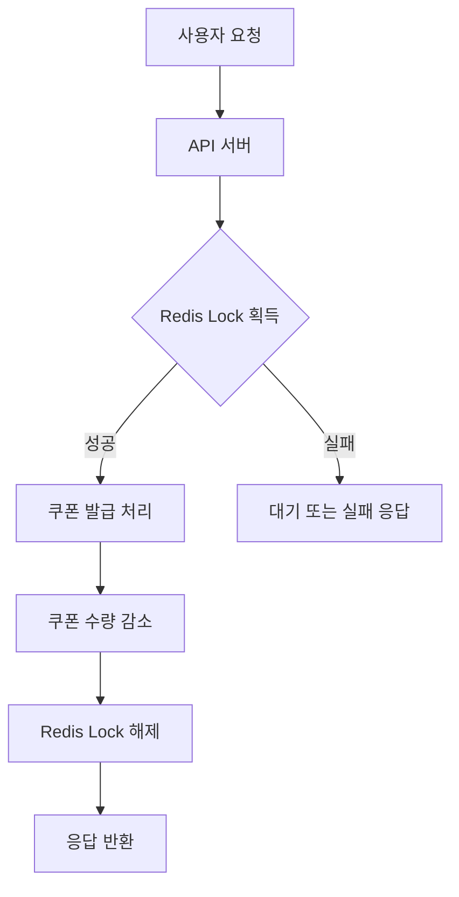
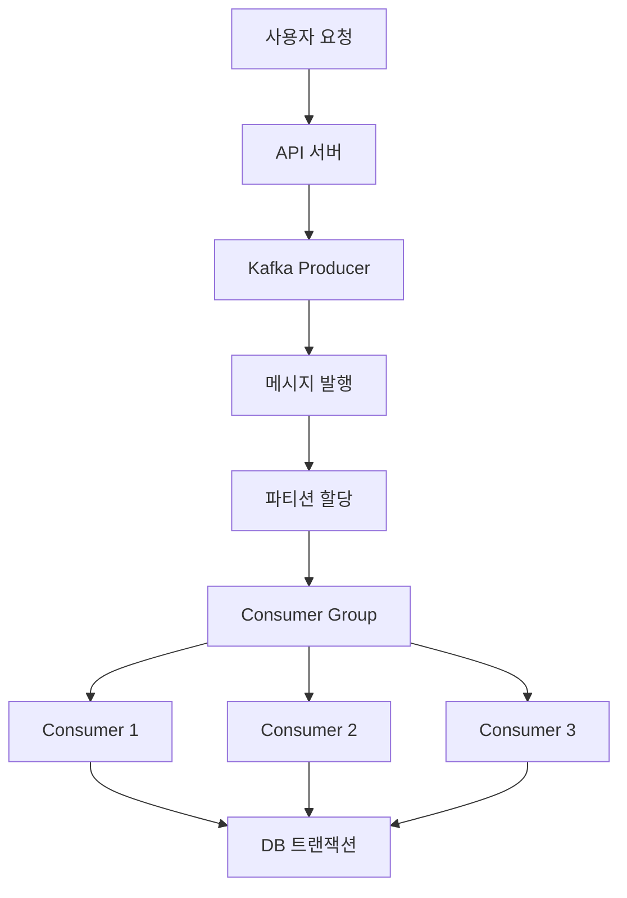

# 카프카를 활용한 대용량 트래픽 처리 설계 문서

## 1. 개요

본 문서는 선착순 쿠폰 발급 시스템에 Apache Kafka를 적용하여 대용량 트래픽을 효과적으로 처리하기 위한 설계 내용을 담고 있습니다. 기존 시스템의 한계를 극복하고 확장성과 안정성을 높이기 위한 아키텍처 변경 사항과 그 효과를 설명합니다.

## 2. 기존 시스템의 한계

선착순 쿠폰 발급 시스템은 다음과 같은 문제에 직면했습니다:

1. **동시성 제어 이슈**: 많은 사용자가 동시에 쿠폰을 신청할 경우 데이터베이스 락 경합으로 인한 성능 저하
2. **시스템 부하 집중**: 특정 시간에 트래픽이 집중되어 시스템 전체 성능 저하
3. **확장성 한계**: 트래픽 증가에 따른 수평적 확장의 어려움
4. **초과 발급 위험**: 트랜잭션 처리 과정에서 쿠폰이 초과 발급될 위험

## 3. 카프카 기반 아키텍처

### 3.1 아키텍처 개요



### 3.2 구성 요소

1. **API 서버 (Producer)**: 클라이언트 요청을 받아 Kafka에 메시지 발행
2. **Kafka Cluster**:
   - 메시지 브로커로서 쿠폰 발급 요청을 큐에 저장
   - 다수의 파티션을 통한 병렬 처리 지원
3. **Consumer 서버**: Kafka로부터 메시지를 소비하여 실제 쿠폰 발급 로직 처리
4. **데이터베이스**: 쿠폰 및 사용자 정보 저장

## 4. 시퀀스 다이어그램

### 4.1 쿠폰 발급 요청 처리 흐름



## 5. Kafka 구성 상세

### 5.1 토픽 설계

| 토픽명                 | 파티션 수 | 복제 팩터                   | 보관 기간 | 설명                           |
| ---------------------- | --------- | --------------------------- | --------- | ------------------------------ |
| coupon-publish-request | 3         | 1 (개발환경) / 3 (운영환경) | 7일       | 쿠폰 발급 요청 메시지          |
| coupon-publish-result  | 3         | 1 (개발환경) / 3 (운영환경) | 7일       | 쿠폰 발급 결과 메시지 (선택적) |

### 5.2 메시지 구조

#### 쿠폰 발급 요청 메시지

```json
{
  "userId": 123456,
  "couponCode": "SUMMER",
  "requestId": "550e8400-e29b-41d4-a716-446655440000"
}
```

### 5.3 파티셔닝 전략

- **키 기반 파티셔닝**: 쿠폰 코드를 메시지 키로 사용하여 동일 쿠폰에 대한 요청이 항상 같은 파티션으로 라우팅되도록 구성
- **장점**:
  - 동일 쿠폰에 대한 요청 처리 순서 보장
  - 파티션 별 병렬 처리를 통한 처리량 향상

## 6. 성능 개선 전략 및 확장 방안

### 6.1 확장 옵션 비교

| 확장 전략         | 장점                  | 단점                           | 적합한 상황             |
| ----------------- | --------------------- | ------------------------------ | ----------------------- |
| Producer 수 증가  | 요청 처리 용량 증가   | 브로커 부하 증가               | API 서버가 병목일 때    |
| Consumer 수 증가  | 메시지 처리 속도 향상 | Consumer Group 리밸런싱 발생   | 메시지 처리가 병목일 때 |
| Partition 수 증가 | 병렬 처리 수준 향상   | 메타데이터 증가, 리밸런싱 발생 | 처리량 증가가 필요할 때 |

### 6.2 처리량 증가를 위한 최적 전략

선착순 쿠폰 발급 시나리오에서 가장 효과적인 확장 전략은 **파티션 수 증가**입니다:

1. **파티션 증가의 효과**:

   - 다양한 쿠폰을 병렬적으로 처리 가능
   - Consumer 확장 시 처리 용량 증가
   - 메시지의 더 높은 처리량 달성

2. **주의사항**:
   - 파티션이 너무 많으면 브로커 부하 및 리밸런싱 시간 증가
   - 토픽 생성 후 파티션 수 증가는 가능하나 감소는 불가능

## 7. Redis vs Kafka 비교

### 7.1 Redis 기반 동시성 제어



### 7.2 Kafka 기반 병렬 처리



### 7.3 접근 방식 비교

| 항목      | Redis 기반                  | Kafka 기반                   |
| --------- | --------------------------- | ---------------------------- |
| 응답 시간 | 빠름 (동기 처리)            | 비동기 처리로 초기 응답 빠름 |
| 확장성    | 제한적 (락 경합 발생)       | 높음 (파티션 기반 병렬 처리) |
| 장애 대응 | 락 해제 실패 시 복구 어려움 | 자동 리밸런싱 및 메시지 보존 |
| 처리량    | 보통                        | 높음                         |
| 복잡성    | 낮음                        | 중간~높음                    |

### 7.4 하이브리드 접근법

최적의 성능을 위해 두 기술의 장점을 결합한 하이브리드 접근법을 고려할 수 있습니다:

- Kafka: 요청 큐잉 및 부하 분산
- Redis: Consumer 내에서 세밀한 동시성 제어

## 8. 결론 및 권장사항

### 8.1 권장 구성

1. **토픽 구성**:

   - 파티션 수는 예상 최대 Consumer 수의 2배로 설정
   - 운영 환경에서는 복제 팩터 3 이상 권장

2. **Consumer 그룹**:

   - 서비스별 별도 Consumer 그룹 구성
   - Consumer 인스턴스는 파티션 수보다 적게 유지

3. **메시지 키 설계**:
   - 쿠폰 코드를 메시지 키로 사용하여 순서 보장
   - 데이터 분산을 위해 키 분포 고려

### 8.2 모니터링 지표

- **Producer 지표**: 메시지 발행 성공률, 지연 시간
- **Broker 지표**: 파티션별 메시지 수, 디스크 사용량
- **Consumer 지표**: 처리량, 지연(lag), 실패율

### 8.3 장애 대응 전략

1. **Consumer 장애**: 리밸런싱을 통한 자동 복구
2. **Broker 장애**: 복제본을 통한 고가용성 유지
3. **네트워크 장애**: 재시도 로직 및 데드레터 큐 구현
